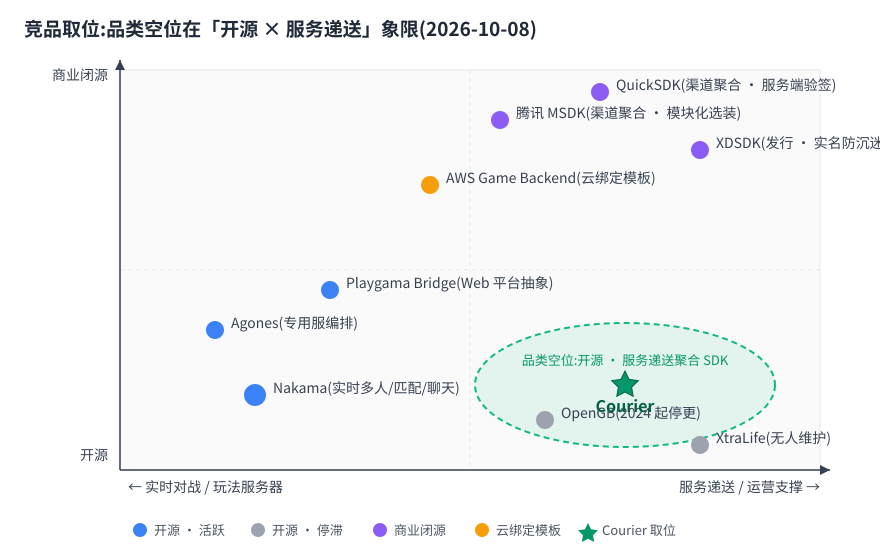

# Competitive Research: Courier's Positioning and Boundaries

> Data basis: GitHub star counts/activity verified via the GitHub API, **as of 2026-10-13** (batch 55 re-check: only Nakama moved 13,478→13,495 with the activity month shifted; all other star counts/stalling states unchanged, external links verified 200 one by one); commercial products are based on official documentation. This document only inventories and infers; it does not endorse; links are given with the claims, and broken links should be reported via an issue.

## One-Sentence Conclusion

The category of "cross-engine client SDK + service delivery aggregation" is a gap in the open-source world: open source is strong at game servers (Nakama), commercial products are strong at channel aggregation (MSDK/QuickSDK/XDSDK), and **nobody manages "account + announcements + support + payments + compliance + config" as a cross-engine unified contract**. Courier takes this position; at the same time it explicitly does not do realtime multiplayer/matching or channel aggregation.

## Open-Source Direct Competitors

> **Bottom line up front: the open-source camp has no "service-aggregation SDK" — the nearest, Nakama, is a different species entirely; the rest are either stalled or cloud-bound.**

| Project | Positioning | Stars | Activity (last push) | Difference from Courier |
| --- | --- | --- | --- | --- |
| [Nakama](https://github.com/heroiclabs/nakama) | Open-source game server (realtime multiplayer/matching/leaderboards/chat/social) | 13,495 | 2026-10 (active, Go, Apache-2.0) | It is **a whole server**; Courier is a client SDK + lightweight gateway and does not touch realtime multiplayer/matching |
| [Open Game Backend (OpenGB)](https://github.com/OpenGameBackend/OpenGameBackend) | Modular scriptable game backend (TypeScript, Rivet-affiliated) | main repo 2; plugins 57/10/5 | Stalled since 2024-11; [the Rivet side is archived](https://github.com/rivet-dev/toolchain) | Closest direction but stalled/absorbed — a cautionary tale for the category |
| [XtraLife](https://github.com/xtralifecloud/xtralife-server) | Open-source game BaaS (formerly Clan of the Cloud, Node.js) | 5 | 2024-10 (sporadic), most org repos stalled 2016–2022 | A user/storage/currency BaaS with no announcements/support/compliance surface; effectively unmaintained |
| [Playgama Bridge](https://github.com/Playgama/bridge) ([Unity version](https://github.com/Playgama/bridge-unity)) | Platform abstraction SDK that publishes HTML5 games to 20+ web platforms with one click | 121 / 56 | 2026-10 (active, TS/LGPL, C#/MIT) | It abstracts "**publishing platforms**" (Poki/CrazyGames/Yandex); Courier abstracts "**game service backends**"; a web bridge is not a general-purpose services SDK |
| [AWS Game Backend Framework](https://github.com/aws-solutions-library-samples/guidance-for-custom-game-backend-hosting-on-aws) | Backend template composed of AWS managed services (Cognito/AppSync/DynamoDB and similar Guidance) | 60 | 2026-08 | Cloud-bound infrastructure template, not an engine SDK; Courier is cloud-neutral and SDK-first |

### Nakama: The Nearest Neighbor, a Different Species

Nakama is the highest-quality open-source project in this space, deserving respect and having clear boundaries:

- Its core value is **server capabilities** (realtime multiplayer, matching, leaderboards, chat); the client SDK is the access layer to its server.
- Its account system is bound to Nakama's own server; announcements, support tickets, payment delivery, real-name compliance, and remote config are not in its capability surface.
- Courier's core value is **client-side contract and capability orchestration**: the Gateway is merely the implementer of the contract, and the backend can be replaced wholesale. The two can coexist (the game uses Nakama for battle servers and Courier for accounts/announcements/support/payment delivery) — they are not mutually exclusive.

## Commercial References (closed source; look at direction, not code)

> **Bottom line up front: commercial aggregation proves the demand is real, and the common trend is "modular on-demand selection + UI stripped to the game + compliance built in" — all three corroborate Courier's design.**

| Product | Angle of entry | Lesson for Courier |
| --- | --- | --- |
| [Tencent MSDK](https://docs.msdk.qq.com/) | Login channels (WeChat/QQ/Facebook/GameCenter/GooglePlay), payments, Bugly and the rest all **plugged in and selected on demand** (modules chosen when downloading from the GCloud console, see [module descriptions](https://docs.msdk.qq.com/v5/zh-CN/Module/Modules.html), [PC integration](https://docs.msdk.qq.com/v5/zh-CN/Access/PC.html)) | "On-demand selection" validates Courier's Provider/optional-package design; commercial aggregation proves the demand is real |
| [QuickSDK](https://www.quicksdk.com/) | China domestic mobile-game channel aggregation (login + top-up), co-publishing distribution; emphasizes server-side token verification against forgery | Channel aggregation is a distribution-side business, which Courier does not do; but the security posture "credentials obtained by the client must be server-verified" is identical |
| [XDSDK](https://sdk-docs.xindong.com/anti-addiction) ([doc center](https://xindong.github.io/XDSDK-Doc/), [PC SDK](https://github.com/xd-platform/XDSDK-UE-PC)) | TapTap login/payment; the real-name anti-addiction module (stripped out starting v6.4.0, pointing to [TapSDK compliance certification](https://developer.taptap.cn/docs/v3/sdk/anti-addiction/guide), split into "already has a game license / no license yet" plans) | Two lessons: ① real-name anti-addiction is a **must-have compliance item** for domestic SDKs (confirming the necessity of Courier RealName); ② the trend of the game drawing its own login UI while the SDK strips UI matches Courier's "UI is always optional" posture |

## Three Conclusions

**1. The category has a gap: open source has no "service-aggregation SDK".**
In the open-source camp, Nakama owns the server; OpenGB/XtraLife are stalled or unmaintained; AWS's solution is cloud-bound — nobody runs "account + announcements + support + payment delivery + compliance + remote config" as a cross-engine client-side unified contract. Commercial aggregation (MSDK/QuickSDK/XDSDK) is closed source, channel-bound, and bound to distribution systems, and does not serve teams building their own backends. Courier takes the position: an open-source "service delivery aggregation SDK" with an open, swappable backend Provider.

**2. Copy two things: Nakama's multi-engine engineering practice + MSDK's modularized selection.**
What is worth copying from Nakama is the engineering side: every engine is a first-class citizen, examples and docs are at parity, and contract behavior is consistent across platforms (exactly what Courier's M0 constitution must guarantee). What is worth copying from MSDK is the product side: all features are pluggable, selected on demand, and removable (the same philosophy as Courier's "Provider swappable and shutoff + UI/Diagnostics optional packages", corroborating each other).

**3. Boundaries: realtime and channels, not doing.**
Realtime multiplayer/matching/lobby servers are Nakama / Agones's territory, which Courier does not touch; channel-package aggregation and co-publishing are MSDK / QuickSDK / XDSDK's territory, which Courier does not touch. Courier is "the gate between the player world and the game service ecosystem": the service delivery layer. This boundary is also written into the [roadmap non-goals](../roadmap.md).

## Reference-Worthy Analysis

> **Bottom line up front: of the 9 benchmark targets, 6 are reference-worthy/borrowable (all already have or will have landing points in this repo), 3 are not applicable (boundary evidence).**

| Target / practice | Verdict | Why | Where it lands in this repo |
| --- | --- | --- | --- |
| Nakama's multi-engine engineering practice (every engine first-class, contract behavior consistent across platforms) | ✅ worth referencing | "Consistent across platforms" is the scarcest promise in this category, and Nakama proved it is maintainable in the open-source world | The five-layer architecture and the L1 contract test skeleton (`tools/contractgen` six-platform generation, drift turns tests red, [todo batch 1](../todo.md) landed); per-platform Adapters advance batch by batch |
| Nakama's realtime multiplayer/matching/lobby/chat | ⬜ not applicable | Gameplay-server capabilities; Courier's positioning is the service delivery layer; building them in would make it a second Nakama | [roadmap non-goals](../roadmap.md) (registered, maintained) |
| OpenGB's modular scriptable backend | ⚠️ worth borrowing (cautionary) | The direction closest to Courier, yet stalled and absorbed by Rivet — the lesson: **freeze the contract first, keep the core small and the ecosystem large**, otherwise plugin repos lose focus | M0's "contract first" (primitives + auth + the M2 three domains frozen before implementation started); Provider interface shapes frozen at batch 2 rather than growing openly |
| XtraLife's open-source BaaS | ⬜ not applicable | No announcements/support/compliance surface and effectively stopped maintaining; nothing engineering-wise to copy | — (serves only as side evidence of category stagnation) |
| Playgama Bridge's 20+ platform adaptation organization | ⚠️ worth borrowing | It abstracts "publishing platforms" while Courier abstracts "service backends" — two categories; but its organization of "pressing all platform differences into one adaptation layer" is worth mirroring | The L3 Adapter boundary ([layers.md](../layers.md)): platform differences only enter the Adapter, Core never touches platforms (guarded by packcheck structure acceptance) |
| AWS Game Backend Framework | ⬜ not applicable | Cloud-bound infrastructure template, the opposite of the "cloud-neutral, SDK-first" positioning | — (serves as a foil for the cloud-neutral principle; Gateway/Provider are not cloud-bound) |
| MSDK's modularized on-demand selection | ✅ worth referencing | Commercial aggregation validated that "not paying size for features you don't use" is a real paying demand | The Provider swappable-and-shutoff principle + the four UPM packages (core/service/ui/diagnostics); Diagnostics/UI are always optional |
| QuickSDK's server-side token verification stance | ✅ worth referencing | "Client credentials are untrusted and must be server-verified" holds across categories (login credentials and payment receipts alike) | The [auth.md](../contract/auth.md) Token model (Bearer + rotation + revocation, frozen); payment receipt validation was frozen along with M5 (payment.md) |
| XDSDK's real-name anti-addiction (module stripped to TapSDK) | ✅ worth referencing | Domestic compliance is a hard store-listing gate, and "real name as the default path rather than an extension module" has been validated by top publishers | The [realname.md](../contract/realname.md) contract + [todo batch 7](../todo.md) hot-swap/degradation chain/circuit breaker; the red line (off by default, data scope stated explicitly when enabled) is written into the contract constitution |
| The login-UI stripping trend of XDSDK/MSDK | ✅ worth referencing | That a delivery-type SDK should not bind UI is the industry's common direction | `com.courier.ui` as a separate optional package; Core has no branding logic and no forced UI (layers.md L2/L3 boundary) |
