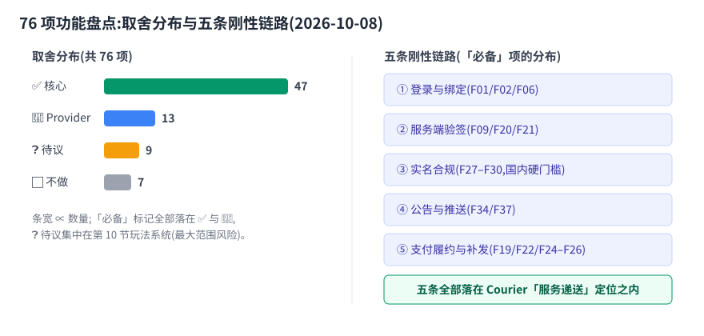

[English](./features.en.md) | [中文](./features.md)

# Feature Survey: A Common Feature Inventory of Game SDKs on the Market

> **Basis**: samples in §0; search and cross-check date **2026-10-08**; every conclusion traces back to the links at the end of this document.
> This document is a **feature-dimension** granularity inventory — competitive positioning, star counts, and the three conclusions live in [competitive.md](./competitive.en.md); this document only adds the layer below it: which features "a game SDK should have" in this category.
> **Commonness** is a qualitative three-tier scale: `must-have` (almost all co-publishing / cloud-service samples have it; without it you cannot integrate or cannot pass store review) / `common` (most general-purpose SDKs provide it, but layered by product) / `bonus` (only a few or vertical products have it).
> The **Courier trade-offs** are research recommendations, to be read against [roadmap non-goals](../roadmap.en.md) and the five-layer architecture; they are not commitments.

## 0. Samples and Method

> **Bottom line up front: the 14 categories of samples span four quadrants — cloud BaaS / co-publishing aggregation / vertical SaaS / compliance posture — enough to anchor the full set of "what a game SDK should have".**

| Sample | Type | Feature surface covered |
| --- | --- | --- |
| [Nakama](https://github.com/heroiclabs/nakama) | Open-source game server | Account linking, cloud saves, leaderboards, IAP receipt validation (details in [competitive.md](./competitive.en.md)) |
| [Firebase for Games](https://firebase.google.com/docs/games/setup) | General mobile BaaS | Auth, remote config, push, in-app messaging, crash |
| [Unity Gaming Services](https://docs.unity.com/en-us/services) | Engine vendor LiveOps | Auth, cloud save, economy, leaderboards, push, remote config |
| [Epic Online Services](https://github.com/api-evangelist/epic-games/blob/main/apis.yml) | Cross-platform online services | Identity, social, progression, storage, compliance (sanctions), commerce |
| [Google Play Games services](https://support.google.com/googleplay/android-developer/answer/2990418) | Platform SDK | Achievements, leaderboards, cloud saves, identity |
| [AccelByte AGS](https://accelbyte.io/) | Commercial modular backend | Accounts, cloud saves, store, seasons, telemetry |
| [Tencent MSDK](https://docs.msdk.qq.com/v5/zh-CN/Module/Notice.html) | China co-publishing aggregation | Announcements, push, modular on-demand selection |
| [XDSDK / TapTap TapSDK](https://sdk-docs.xindong.com/) | Publishing platform SDK | Login, payment, real name / anti-addiction, data, customer support |
| [QuickSDK](https://www.quicksdk.com/) | Channel aggregation | Login, top-up, server-side verification |
| [GamePush](https://gamepush.com/en/backend/) / [BACKND](https://backnd.com/en/) | Lightweight game BaaS | Cloud saves, payments, leaderboards, announcements, tickets, push |
| [Helpshift](https://www.helpshift.com/blog/mobile-game-support-sdk/) / [Zendesk for Unity](https://www.zendesk.com/blog/unity-zendesk-partnership/) | Customer-support vertical | In-game tickets, FAQ, context pass-through |
| [GameAnalytics](https://docs.gameanalytics.com/event-tracking-and-integrations/advanced-tracking/purchase-validation/) / [ByteBrew](https://github.com/ByteBrewIO/ByteBrewAndroidSDK) / [Umeng](https://devs.umeng.com/) | Data/attribution vertical | Analytics events, payment validation, attribution, remote config, A/B |
| Industry sources: [Tencent Cloud "What a mobile game SDK can do"](https://cloud.tencent.com/developer/article/1856528), ["Version operations and GM tools"](https://cloud.tencent.com/developer/article/1978643) | Chinese-language industry material | Co-publishing SDK must-haves, live-ops tooling surface |
| Compliance sources: [TapTap compliance certification](https://developer.taptap.cn/docs/sdk/anti-addiction/features/), [COPPA/GDPR practice](https://www.strapdata.com/gdpr-coppa-compliance-gaming/), [GameAnalytics privacy posture](https://www.gameanalytics.com/trust/privacy-faq) | Compliance | Real name, anti-addiction, consent and account deletion |

**Method**: first enumerate features along the lifecycle slice "player installs the game to churn", then check each sample for whether it provides the feature, and finally annotate commonness and the Courier trade-off. There are 14 categories of samples in total; a feature enters the table only with at least 2 independent sources.

---

## 1. Accounts and Identity

> **Bottom line up front: login aggregation, binding-to-upgrade, and anonymous-first (F01/F02/F06) are must-haves across the entire category — the M1 chain is already implemented per contract.**

| ID | Feature | Typical capability | Commonness | Representative implementations | Trade-off |
| --- | --- | --- | --- | --- | --- |
| F01 | Login method aggregation | Guest, self-hosted account, phone/email, third-party OAuth (Apple / Google / Steam / WeChat / QQ / Facebook); exposes a unified login API to the game | must-have | [Nakama identity linking](https://deepwiki.com/heroiclabs/nakama-godot/3-nakama-game-backend), [XDSDK account management](https://sdk-docs.xindong.com/), [MSDK modules](https://docs.msdk.qq.com/v5/zh-CN/Module/Modules.html) | ✅ core |
| F02 | Account binding / unbinding / merging | One account linked to multiple platform identities (`link_device/email/steam...`), guest identity upgrades and merges into a formal account | must-have | Nakama `link_*`, [XDSDK bind/unbind](https://sdk-docs.xindong.com/) | ✅ core |
| F03 | Account deletion and data erasure | Complete deletion flow + downstream data cascade deletion (GDPR `erasure`; app stores both require an entry **reachable in-game**) | must-have | [XDSDK deletion flow](https://sdk-docs.xindong.com/), [store policy stance](https://privacyterms.io/privacy-policy-for-mobile-game) | ✅ core |
| F04 | Cross-platform identity continuity | The same player shares progress and identity across PC/console/mobile, keyed by platform ID to retrieve saves | common | [EOS Connect](https://github.com/api-evangelist/epic-games/blob/main/apis.yml), [PGS quality checklist 1.4](https://developer.android.com/games/pgs/quality), [AccelByte 15+ platforms](https://accelbyte.io/) | ✅ core |
| F05 | Game-drawn login UI / SDK ships without UI | The SDK only provides data and callbacks; the UI is implemented by the game; or it offers an optional default UI | common | [XDSDK UI-stripping trend](https://sdk-docs.xindong.com/), [MSDK announcements give data only, no UI](https://docs.msdk.qq.com/v5/zh-CN/Module/Notice.html) | ✅ core (UI always optional) |
| F06 | Anonymous login and silent auto-login | Enter the game first, add the account later: anonymous sign-in, UI-free platform-side auto-authentication, then bind a formal identity | must-have | [Unity Authentication anonymous/platform login](https://docs.unity.com/en-us/services-web-apis/client-auth), [PGS auto-auth quality item 1.1](https://developer.android.com/games/pgs/quality) | ✅ core |
| F07 | Account risk control and anti-abuse | Device fingerprinting, abnormal login detection, ban/unban, tiered penalties (ban gameplay / ban leaderboards) | common | [Live-ops penalty types](https://cloud.tencent.com/developer/article/1978643), [BACKND reports and penalties](https://backnd.com/en/) | 🔌 Provider |

**Courier trade-off**: F01–F06 are the main body of the M1 auth contract (the account is a company-level entity, `player` is a game-scoped entity, see [scope.md](../contract/scope.en.md)); F07 risk control goes through Provider and does not enter the core contract.

## 2. Sessions, Tokens, and Call Security

> **Bottom line up front: this entire section is uncontroversial and all core — client credentials are untrusted, server-side signature verification is an iron rule.**

| ID | Feature | Typical capability | Commonness | Representative implementations | Trade-off |
| --- | --- | --- | --- | --- | --- |
| F08 | access / refresh tokens and automatic renewal | Short-lived access tokens + session token re-signing, silent refresh on expiry, without interrupting the game | must-have | [Unity Authentication tokens](https://docs.unity.com/en-us/services-web-apis/client-auth), Nakama session refresh | ✅ core |
| F09 | Server-side signature verification (client credentials are untrusted) | Tokens/receipts obtained by the client must be server-verified before rewards are granted; keys live server-side | must-have | [QuickSDK server-side verification stance](https://www.quicksdk.com/), [AWS backend validating client tokens](https://d1.awsstatic.com/events/Summits/reinvent2023/GAM302-R_Build-scalable-cross-platform-game-backends-on-AWS-REPEAT.pdf) | ✅ core |
| F10 | scope / multi-environment isolation | Resources isolated by `game_id + env`, tokens bound to a scope, explicit errors on unauthorized access | common | AccelByte namespace + OAuth2, [Courier scope contract](../contract/scope.en.md) | ✅ core |
| F11 | Unified error codes and retryable semantics | Client-decidable error classification: "retry / degrade / abort" | common | [Courier errors contract](../contract/errors.en.md), EOS REST error classification | ✅ core |
| F12 | Client credential and key management | The embedded game key only does admission, not authorization; real credentials live server-side | must-have | [EOS Developer Portal client credentials](https://github.com/api-evangelist/epic-games/blob/main/apis.yml) | ✅ core |

**Courier trade-off**: the entire section is core — exactly the same posture as "client credentials must be server-verified" in [competitive.md](./competitive.en.md) conclusion 3.

## 3. Player Data and Cloud Saves

> **Bottom line up front: player profiles enter the core; cloud saves stay with Provider — no unified-wallet assumption.**

| ID | Feature | Typical capability | Commonness | Representative implementations | Trade-off |
| --- | --- | --- | --- | --- | --- |
| F13 | Cloud saves / progress sync | Store progress across devices, write locally while offline and sync once online | must-have | [UGS Cloud Save](https://docs.unity.com/en-us/cloud-save/get-started), [PGS saved games](https://support.google.com/googleplay/android-developer/answer/2990418), [GamePush cloud saves](https://gamepush.com/en/backend/) | ❓ under discussion |
| F14 | Tiered read/write permissions | Layered by visibility: owner read-write / public read-only / server-only write (anti-cheat data) | common | [UGS four access levels](https://docs.unity.com/en-us/cloud-save/get-started) (Default/Public/Protected/Custom) | ❓ under discussion |
| F15 | Write locks and conflict merging | Optimistic locking / version numbers for concurrent writes, preventing two sides from overwriting each other | bonus | UGS `SaveItem` write-lock | ❓ under discussion |
| F16 | Player profile | Nickname, avatar, custom metadata, publicly searchable | must-have | [EOS UserInfo](https://github.com/api-evangelist/epic-games/blob/main/apis.yml), AccelByte Player Profiles | ✅ core (player) |
| F17 | Binary file storage | Object storage for save files, screenshots, UGC attachments | common | UGS Cloud Save Files, [EOS Title/Player Data Storage](https://github.com/api-evangelist/epic-games/blob/main/apis.yml) | 🔌 Provider |
| F18 | Server-authoritative writes | Number-affecting data can only be written by the server/cloud functions; the client only writes preferences | common | [UGS Cloud Code server modules](https://cloud-code-sdk-documentation.cloud.unity3d.com/), [Nakama server logic](https://github.com/heroiclabs/nakama) | ✅ core (Gateway side) |

**Courier trade-off**: F16 / F18 enter the "player" surface core; F13–F15 save-surface stays with Provider, with no unified-wallet assumption.

## 4. Payments and Monetization

> **Bottom line up front: the value of payments lies in "delivery" (validation / idempotency / fulfillment / re-delivery), not in the checkout UI.**

| ID | Feature | Typical capability | Commonness | Representative implementations | Trade-off |
| --- | --- | --- | --- | --- | --- |
| F19 | Payment channel invocation and product list | Apple IAP / Google Billing / WeChat Pay / Alipay / web third-party; products issued server-side | must-have | [XDSDK in-app payments](https://sdk-docs.xindong.com/), [Unity IAP](https://docs.unity.com/en-us/iap/payment-providers/purchases-sdk) | ✅ core (delivery) |
| F20 | Server-side receipt validation | Receipts/vouchers always return to the server and are verified against store APIs (App Store Server API / Google Play Developer API) before rewards are granted | must-have | [Nakama IAP validation](https://heroiclabs.com/docs/nakama/concepts/iap-validation/), [GameAnalytics purchase validation](https://docs.gameanalytics.com/event-tracking-and-integrations/advanced-tracking/purchase-validation/) | ✅ core (Payment Provider) |
| F21 | Idempotency and replay protection | The same receipt/`purchaseToken` can only be credited once; record `seenBefore`; bind the submitting account to prevent cross-account injection | must-have | Nakama `seenBefore`, [transactionId/purchaseToken dedup stance](https://www.opoinstall.com/blog/track-optimize-in-app-purchases) | ✅ core |
| F22 | Product consistency and order fulfillment | Validate product ID against the actual paid amount before granting entitlements (prevents "buy cheap, unlock expensive") | must-have | Nakama product mismatch protection, [Unity IAP fulfillment](https://docs.unity.com/en-us/iap/payment-providers/purchases-sdk) | ✅ core |
| F23 | Subscription state management | Expiry/renewal/refund state follows store server-to-server notifications; supports restore | common | Nakama subscriptions + provider notifications, StoreKit 2 JWS | 🔌 Provider |
| F24 | Cross-device restore purchases | On a new device, pull historical orders to restore entitlements | must-have | [Unity IAP backend fulfillment](https://docs.unity.com/en-us/iap/payment-providers/purchases-sdk) | ✅ core |
| F25 | Transaction ledger and reconciliation | Full transaction ledger, for customer-support re-issuance, refund reconciliation, finance audit | must-have | [Nakama transaction records](https://heroiclabs.com/docs/nakama/concepts/iap-validation/), [live-ops individual top-up records](https://cloud.tencent.com/developer/article/2226974) | ✅ core |
| F26 | Payment callbacks and re-delivery (dropped-order handling) | When payment succeeds but fulfillment is interrupted: query, re-deliver, and a customer-support compensation entry | must-have | [GamePush payment re-delivery](https://gamepush.com/en/backend/), [customer-support compensated purchase](https://theymes.com/for/gaming) | ✅ core |

**Courier trade-off**: the entire section is Courier's differentiating main body — **"payment delivery" = invocation + validation + idempotency + fulfillment + re-delivery**; the form is open (no unified-wallet assumption), and all implementations go through a pluggable Payment Provider.

## 5. Compliance and Minors' Protection

> **Bottom line up front: the China domestic real-name four-piece set is a hard store-review gate and must be the default path, not an optional package.**

| ID | Feature | Typical capability | Commonness | Representative implementations | Trade-off |
| --- | --- | --- | --- | --- | --- |
| F27 | Real name verification | Integration with official real-name systems (China's NPPA anti-addiction real-name system), reported under the developer's entity | must-have (China) | [TapTap compliance certification](https://developer.taptap.cn/docs/sdk/anti-addiction/features/), [MSDK real-name system](https://sdk.kurogames.com/p/sdk_list.html), [Courier realname contract](../contract/realname.en.md) | ✅ core |
| F28 | Playtime and curfew restrictions | Minors may play only on Fridays/Saturdays/Sundays and statutory holidays 20:00–21:00; cloud-side query of playable windows | must-have (China) | [TapSDK anti-addiction](https://developer.taptap.cn/docs/sdk/anti-addiction/features/) | ✅ core |
| F29 | Top-up amount limits | Under 8: no top-ups; 8–16: ≤50 per transaction / ≤200 per month (yuan); 16–18: ≤100 / ≤400 | must-have (China) | TapSDK compliance certification, [XDSDK anti-addiction amount reporting](https://sdk-docs.xindong.com/anti-addict) | ✅ core |
| F30 | Anti-addiction data reporting | Report playtime and spend amounts (prefer server-to-server S2S reporting to avoid duplicate client reports) | must-have (China) | [XDSDK Server-to-Server reporting](https://sdk-docs.xindong.com/anti-addict), [Xiaomi co-publishing SDK playtime collection](https://dev.mi.com/xiaomihyperos/documentation/detail?pId=1376) | ✅ core |
| F31 | Age gate and consent management | Age screening at first launch; below the digital consent age (GDPR 13–16) requires verifiable parental consent (VPC); consent records retained separately | must-have (overseas) | [COPPA/GDPR architecture practice](https://www.strapdata.com/gdpr-coppa-compliance-gaming/), [GameAnalytics consent flow](https://www.gameanalytics.com/trust/privacy-faq) | ✅ core |
| F32 | Data minimization and third-party sharing inventory | Per-SDK inventory of collected items, purposes, permissions; non-essential SDKs off by default, enabled by age tier | must-have (overseas) | [Third-party personal information sharing inventory example](https://sdk.kurogames.com/p/sdk_list.html), [privacy policy stance](https://privacyterms.io/privacy-policy-for-mobile-game) | 🔌 Provider (contractualized output) |
| F33 | Audit and compliance traceability | Traceable logs of real-name / consent / payment-limit determinations, for regulatory and SOC 2-style evidence | common | [Compliance traceability requirements](https://www.strapdata.com/gdpr-coppa-compliance-gaming/) | ✅ core |

**Courier trade-off**: domestic compliance (real name / playtime / limits / reporting) is a **must-have, not an optional package** — confirming [competitive.md](./competitive.en.md)'s judgment on XDSDK; overseas compliance (age gate / consent / deletion) together with F03 forms the default capability of the account surface.

## 6. Messaging and Reach: Announcements / Push / In-App Messages

> **Bottom line up front: announcements are core main body; the push chain is Provider-ized; the in-app channel (M2 messages) contract is frozen.**

| ID | Feature | Typical capability | Commonness | Representative implementations | Trade-off |
| --- | --- | --- | --- | --- | --- |
| F34 | Announcement system | Three forms: text / image / web link; categories, groups, start/end times, languages, ordering; configured in a backend and delivered to clients | must-have | [MSDK announcement module](https://docs.msdk.qq.com/v5/zh-CN/Module/Notice.html), [BACKND announcements](https://backnd.com/en/) | ✅ core |
| F35 | Announcement targeting filters | Filter delivery by OS, channel, openid, device ID, version number, region; the client only receives matching items | common | [MSDK announcement filter fields](https://docs.msdk.qq.com/v5/zh-CN/Module/Notice.html) | ✅ core |
| F36 | Marquee / scrolling server-wide broadcast | Server-wide scrolling messages (prize wins, maintenance, events); same source as announcements, different presentation | common | [Live-ops tools: announcements / marquee / server-wide mail](https://cloud.tencent.com/developer/article/1978643) | ✅ core (messaging) |
| F37 | Remote push | APNs / FCM / China OEM channels; local + remote; two forms: notification bar and in-app messages | must-have | [MSDK push module](https://docs.msdk.qq.com/v5/zh-CN/Module/Push.html), [UGS Push](https://docs.unity.com/en-us/push-notifications/get-started) | 🔌 Provider (default chirp, replaceable) |
| F38 | Account/tag-targeted push | Bind accounts on top of device registration; support tag (gender/age/preference) group delivery | common | MSDK `setAccount` + tag push, [UGS campaign](https://docs.unity.com/en-us/push-notifications/get-started) | 🔌 Provider |
| F39 | Local notifications / scheduled reminders | Client-side local scheduling (stamina recovery, event countdowns), no network dependency | common | MSDK local push, UGS Mobile Notifications | 🔌 Provider |
| F40 | Reach-effect statistics | Send / display / click funnel, with attribution back to campaigns | common | [FCM delivery and reporting](https://firebase.google.com/docs/cloud-messaging), UGS `notificationOpened` event | 🔌 Provider |

**Courier trade-off**: announcements / marquee are Courier's **core main body** ("announcement delivery to the game client"), data only, no UI; the entire push chain is Provider, and it **does not build its own long-connection channel** (a roadmap non-goal).

## 7. Customer Support and Player Feedback

> **Bottom line up front: tickets + FAQ + context pass-through are the customer-support three-piece set, and they mesh naturally with the payment ledger (M2 support contract is frozen).**

| ID | Feature | Typical capability | Commonness | Representative implementations | Trade-off |
| --- | --- | --- | --- | --- | --- |
| F41 | In-game support session / ticket | Ask questions, submit tickets, and view progress without leaving the client | common | [Helpshift in-game SDK](https://www.helpshift.com/blog/mobile-game-support-sdk/), [Zendesk for Unity](https://www.zendesk.com/blog/unity-zendesk-partnership/), [BACKND tickets](https://backnd.com/en/) | ✅ core |
| F42 | FAQ / knowledge-base self-service | Search and browse inside the client; a hit means no ticket (deflection) | common | Zendesk Help Center, Helpshift Quicksearch | ✅ core |
| F43 | Automatic context pass-through | Automatically attach player ID, platform, build number, level, purchase history — no more "what is your ID?" | common | [Theymes context pass-through](https://theymes.com/for/gaming), [Helpshift context](https://www.helpshift.com/blog/mobile-game-support-sdk/) | ✅ core |
| F44 | Player feedback and log upload | One-tap feedback with screenshots and client logs attached, for easier reproduction | common | [MSDK modular on-demand selection](https://docs.msdk.qq.com/v5/zh-CN/Module/Modules.html), [GamePush player feedback](https://gamepush.com/en/backend/) | ✅ core |
| F45 | Reports and penalty appeals | Player reports, ban notifications, appeal entry, and a handling loop | common | [EOS Reports / Sanctions appeal](https://github.com/EpicGames/EOS-Getting-Started), [BACKND reports and penalties](https://backnd.com/en/) | ✅ core |
| F46 | Support-side re-issuance / compensation | Support queries transactions by account, re-issues items, handles refunds | common | [Customer-support compensated purchase scenarios](https://theymes.com/for/gaming), [player support tool comparison](https://playerdriven.io/blog/best-player-support-tools-for-game-studios-in-2026) | ✅ core |

**Courier trade-off**: the entire section is Courier's **core main body** (support delivery), and it meshes naturally with the F25 transaction ledger: tickets automatically carry context + re-issuance goes through the same payment Provider.

## 8. Live-Ops Configuration and Experiments

> **Bottom line up front: the delivery chain is core; the ops UI is not self-built — the delivery layer does not build every layer's UI.**

| ID | Feature | Typical capability | Commonness | Representative implementations | Trade-off |
| --- | --- | --- | --- | --- | --- |
| F47 | Remote config / Feature Flags | Change numbers and toggle gameplay without a release; support gradual rollout and **second-level rollback** | must-have | [Firebase Remote Config](https://firebase.google.com/docs/remote-config), [UGS Remote Config](https://cloud-code-sdk-documentation.cloud.unity3d.com/) | ✅ core |
| F48 | Audience and conditional targeting | Deliver different configs by version, language, audience, device, custom conditions | common | [Firebase audiences and conditions](https://firebase.google.com/docs/remote-config), MSDK announcement filtering, same idea | ✅ core |
| F49 | A/B experiments | Automatic control groups, metric significance determination, with Crashlytics/analytics for stability | common | [Firebase A/B Testing](https://firebase.google.com/products/remote-config), [ByteBrew A/B](https://github.com/ByteBrewIO/ByteBrewAndroidSDK) | 🔌 Provider |
| F50 | Config version history and rollback | Keep multi-version templates, record who changed what, one-click revert to a historical version | common | [Firebase Remote Config](https://firebase.google.com/docs/remote-config) | ✅ core |
| F51 | GM / live-ops tooling UI | User info queries, resource grants, server open/close and maintenance, whitelists, feature flags, penalties | must-have (ops side) | ["Version operations and GM tools"](https://cloud.tencent.com/developer/article/1978643), [BACKND admin console](https://backnd.com/en/) | ⬜ out of scope for the UI (default Croupier, API retained) |

**Courier trade-off**: the config/toggle **delivery chain** is core (the Gateway only delivers data; UI is always optional); the ops **UI** is not self-built, defaulting to Provider Croupier — consistent with the roadmap non-goals.

## 9. Data, Crash, and Attribution

> **Bottom line up front: not self-built anywhere in the verticals; Courier only keeps its own observability (the diagnostics contract).**

| ID | Feature | Typical capability | Commonness | Representative implementations | Trade-off |
| --- | --- | --- | --- | --- | --- |
| F52 | Analytics events and behavior analysis | Sessions, level start/end, funnels, D1/D7/D30 retention, audience drill-down | must-have | [GameAnalytics](https://www.gameanalytics.com/blog/how-to-integrate-analytics-into-a-game), [Umeng U-Game](https://devs.umeng.com/), [ByteBrew](https://github.com/ByteBrewIO/ByteBrewAndroidSDK) | 🔌 Provider |
| F53 | Payments and ad revenue statistics | Pay rate, ARPU/ARPDAU, combined in-app + ad revenue | must-have | [ByteBrew monetization tracking](https://github.com/ByteBrewIO/ByteBrewAndroidSDK), [Umeng](https://devs.umeng.com/) | 🔌 Provider |
| F54 | User-acquisition attribution | Channel install attribution, SKAN, deep-link / deferred deep-link callbacks | common | AppsFlyer / Adjust (AppsFlyer/Adjust are industry common knowledge, see [attribution stance](https://newagesysit.com/mobile-gaming-application-development-services/)) | ⬜ out of scope (vertical domain) |
| F55 | Crash and performance monitoring | Crash clustering, breadcrumbs, distribution by build/version, alerting to Slack/Jira | must-have | [Firebase Crashlytics](https://firebase.google.com/docs/games/setup), [XDSDK Crashlytics integration](https://sdk-docs.xindong.com/) | 🔌 Provider |
| F56 | Server/SDK telemetry | Call volume, latency, status codes, SDK's own health | common | [EOS QoS metrics](https://endlessrunner.co.uk/privacy-policies/epic-online-services-developer-terms), [AccelByte Game Telemetry](https://github.com/api-evangelist/accelbyte/blob/main/README.md) | ✅ core (diagnostics contract) |
| F57 | Data export | Export to BigQuery/S3/self-hosted warehouse, for audit and secondary analysis | bonus | [Crashlytics data export](https://firebase.google.com/docs/crashlytics), [AIS data warehouse](https://www.metaplay.io/comparisons/metaplay-vs-accelbyte) | 🔌 Provider |

**Courier trade-off**: Courier **does not build its own analytics product** (F52–F55 are all Provider-ized, or simply left to the game's existing analytics stack); it only guarantees the F56 diagnostics contract — the SDK's own observability is the precondition for even talking about "delivery success".

## 10. Progression, Achievements, and Retention Gameplay

> **Bottom line up front: this section is gameplay, not services; everything is listed under discussion to prevent scope creep; only F62 mail / redeem codes warrants follow-up evaluation (already evaluated: see [mail-cdk-evaluation.md](./mail-cdk-evaluation.en.md), delegated decision FW1016D — not initiated; if ops needs trigger it, freeze per sketch).**

| ID | Feature | Typical capability | Commonness | Representative implementations | Trade-off |
| --- | --- | --- | --- | --- | --- |
| F58 | Leaderboards | Global/friend/periodic (daily/weekly/season) boards, custom ordering, pagination, filter by owner | must-have | [Nakama leaderboards](https://deepwiki.com/heroiclabs/nakama-godot/3-nakama-game-backend), [EOS Leaderboards](https://github.com/api-evangelist/epic-games/blob/main/apis.yml), [UGS Leaderboards](https://docs.unity.com/en-us/services) | ❓ under discussion |
| F59 | Achievements / tasks | One-time and incremental achievements, hidden achievements, progress visualization | must-have | [PGS achievements quality checklist](https://developer.android.com/games/pgs/quality), EOS Achievements | ❓ under discussion |
| F60 | Stats | Server-saved player statistics consumed by achievements/leaderboards | common | EOS Stats, AccelByte Statistics | ❓ under discussion |
| F61 | Seasons / passes / daily check-in | Event cycles, reward tracks, daily rewards | common | AccelByte Season Pass, [GamePush reward scheduling](https://gamepush.com/en/backend/) | ❓ under discussion |
| F62 | Mail / redeem codes | Server-wide mail, individual mail, redeem codes; often share a source with live-ops tooling | must-have (ops side) | [Live-ops tools: server-wide & individual mail](https://cloud.tencent.com/developer/article/1978643), [MSDK gift vouchers](https://cloud.tencent.com/developer/article/1856528) | ✅ delegated decision (evaluation complete, not initiated; see [mail-cdk-evaluation.md](./mail-cdk-evaluation.en.md)) |
| F63 | Events and limited-time operations | Event schedules, countdowns, server-launch warm-ups | common | [BACKND events and announcements](https://backnd.com/en/), [SpellSync events](https://spellsync.com/game-backend/) | ❓ under discussion |

**Courier trade-off**: most of this section is **gameplay systems** rather than "service delivery"; except F62 mail, which is adjacent to the messaging surface and worth evaluating first, the rest stay under discussion — avoiding turning Courier into a second Nakama (see [competitive.md](./competitive.en.md) conclusion 3).

## 11. Social and Realtime (Boundary Reference; Listed but Out of Scope)

> **Bottom line up front: the entire section is a roadmap non-goal, drawing the line against Nakama/Agones.**

| ID | Feature | Typical capability | Commonness | Representative implementations | Trade-off |
| --- | --- | --- | --- | --- | --- |
| F64 | Friends and presence | Friend list, online/offline, blocklists | common | [EOS Friends/Presence/Blocklist](https://github.com/api-evangelist/epic-games/blob/main/apis.yml), Nakama friends | ⬜ out of scope |
| F65 | Chat / direct messages | Channels, DMs, realtime messages | common | [SpellSync chat](https://spellsync.com/game-backend/), Nakama chat | ⬜ out of scope |
| F66 | Matchmaking / lobby / sessions | Match pools, rules, latency awareness, dedicated-server orchestration | common | [AccelByte Matchmaking](https://docs.accelbyte.io/gaming-services/modules/multiplayer/matchmaking/unity-integrating-matchmaking/), Nakama | ⬜ out of scope |
| F67 | Realtime voice | Room voice, noise suppression, permissions | bonus | EOS Voice, TapSDK realtime voice | ⬜ out of scope |
| F68 | Guilds / parties | Organization, members, permissions, guild wars | common | Nakama groups, AccelByte Guilds | ⬜ out of scope |

**Courier trade-off**: the entire section is a roadmap [non-goal](../roadmap.en.md), drawing a clear line against Nakama/Agones; Courier only builds the **delivery layer** between them and the player world, and the two can coexist.

## 12. SDK Engineering and Delivery

> **Bottom line up front: all eight are core — exactly the implementation checklist for the two conclusions "copy Nakama's engineering side + MSDK's modularization".**

| ID | Feature | Typical capability | Commonness | Representative implementations | Trade-off |
| --- | --- | --- | --- | --- | --- |
| F69 | Multi-engine first-class citizen | Separate SDKs for Unity / Unreal / Godot / native / C++, with contract behavior consistent across platforms | must-have | [Nakama multi-engine SDK](https://github.com/heroiclabs/nakama), [EOS SDK downloads and Unity/Unreal plugins](https://dev.epicgames.com/documentation/en-us/epic-online-services), [AWS Unity/Unreal/Godot](https://d1.awsstatic.com/events/Summits/reinvent2023/GAM302-R_Build-scalable-cross-platform-game-backends-on-AWS-REPEAT.pdf) | ✅ core (the SDK Contract layer of the five layers) |
| F70 | Modular on-demand selection | Only pull the modules you need; pluggable and removable; never pay size for features you don't use | must-have | [MSDK module selection](https://docs.msdk.qq.com/v5/zh-CN/Module/Modules.html), [AccelByte module layering](https://www.metaplay.io/comparisons/metaplay-vs-accelbyte) | ✅ core (Provider / optional packages) |
| F71 | UI optional / game-drawn | No forced UI in the SDK; the default UI ships as an optional package | common | XDSDK UI stripping, MSDK announcements give data only | ✅ core |
| F72 | Initialization and lifecycle | Single `Init({gameId, env, endpoint})`; deterministic callbacks for startup, login-state changes, backgrounding | must-have | [Courier scope contract](../contract/scope.en.md), UGS initialization requirements | ✅ core |
| F73 | Weak-network retry and offline degradation | Timeout/offline retry with backoff; local cache fallback for read-only content like announcements | common | [offline-sync stance](https://developer.android.com/games/pgs/quality) (store locally first, sync after auth) | ✅ core |
| F74 | Log and diagnostics switches | Adjustable log level, request trace ids, reportable SDK-side errors | must-have | [EOS SDK and docs](https://dev.epicgames.com/documentation/en-us/epic-online-services), [Courier diagnostics contract](../contract/diagnostics.en.md) | ✅ core |
| F75 | Sandbox / test environments | dev/staging/prod isolation; store sandbox receipts; mocks and fixtures for CI | must-have | [Courier scope three environments](../contract/scope.en.md), store sandbox validation | ✅ core |
| F76 | Multilingual and localization | Content delivered by language; SDK copy is localizable | common | [MSDK announcement language field](https://docs.msdk.qq.com/v5/zh-CN/Module/Notice.html), [multilingual support](https://theymes.com/for/gaming) | ✅ core |

**Courier trade-off**: almost the entire section is core — [competitive.md](./competitive.en.md) conclusion 2 explicitly calls for copying Nakama's engineering side and MSDK's modularization, and these eight items are that checklist.

---

## 13. Cross-Cutting Conclusions

> **Statistics (2026-10-08)**: this document has **14 sections** and **76 features** (F01–F76); trade-off distribution: ✅ core 47 / 🔌 Provider 13 / ❓ under discussion 9 / ⬜ out of scope 7.

**① Must-haves cluster in five chains.** Spread the `must-have` markers out and a game SDK has only five rigid features: login and binding (F01/F02), server-side signature verification (F09/F20/F21), real-name compliance (F27–F30), announcements and push (F34/F37), payment fulfillment and re-delivery (F19/F22/F24/F25/F26). **All five fall within Courier's positioning** (push goes through Provider, but the delivery semantics are unchanged) — this is no coincidence: the boundary of the "service delivery" category is drawn by exactly these chains.

**② "Delivery"-type features are almost all "data + callbacks"; UI is always deferred.** MSDK announcements explicitly give data only, UI is up to the game; XDSDK strips the login UI for the game to draw; Helpshift/Zendesk support SDKs, by contrast, do ship UI (because support UI is their product proper). **Pattern: the more backend-delivery-shaped the feature, the less the SDK should carry UI; the more vertical the SaaS, the more the SDK binds through UI.** Courier is in the former camp, which supports [competitive.md](./competitive.en.md)'s "UI always optional".

**③ Compliance is not an optional package; it is a region-specific default.** China domestic real-name / playtime / limits / reporting is a hard store-review gate; overseas age gate / consent / deletion is a hard store-policy gate. Any "general-purpose game SDK" must make these the default path rather than an extension module — which is also why, even after XDSDK strips anti-addiction out to TapSDK, it still emphasizes it first in its docs.

**④ Verticals are explicitly not self-built: analytics, attribution, support products, ops UI.** F52–F55 (analytics/crash/attribution), F51 (ops UI), and F54 (user-acquisition attribution) already have mature specialists in the industry; Courier only keeps the F56 diagnostics contract and the F51 API surface (the UI belongs to Croupier). **A delivery-layer builder should not also build every layer's UI.**

**⑤ The under-discussion zone (Section 10) is the biggest scope risk.** Leaderboards/achievements/seasons appear with very high frequency in the samples (because they are **gameplay**, not **services**) and are easily pushed into scope by "everyone else has it". Recommendation: keep the roadmap posture — evaluate only F62 mail / redeem codes first, leave the rest untouched.

### Relationship to Existing Documents

- Competitive positioning, star counts, three conclusions → [competitive.md](./competitive.en.md) (not repeated here).
- Non-goals and milestones → [roadmap.md](../roadmap.en.md).
- Cross-platform contract primitives → [contract/](../contract/index.en.md) (scope / auth / errors / diagnostics / realname).

## 14. Reference-Worthy Analysis (Item-by-Item Verdicts and Landing Points)

> **Bottom line up front: of the 76 features, 8 are implemented and verified, 12 are worth referencing, 5 are worth borrowing with adaptation, and 12 groups are not applicable (the rest are under-discussion/Provider items already judged in the tables); every reference-worthy item is given a landing point in this repo.**

Verdict criteria: **worth referencing** = should and can enter this repo's design/scheduling (a landing point is given); **worth borrowing** = the direction or lesson is valuable but the form is not copied verbatim; **not applicable** = conflicts with the "service delivery" positioning and is explicitly out of scope.

| Item | Verdict | Why | Where it lands in this repo |
| --- | --- | --- | --- |
| F01/F02/F06 login aggregation, binding-to-upgrade, anonymous-first | ✅ worth referencing (implemented) | One of the five rigid chains; the M1 full chain (guest → binding → logout → rotation → revoked-rejection) is verified bidirectionally | [auth.md](../contract/auth.en.md) Frozen v1; [todo](../todo.en.md) batch 3 (gateway e2e) / batch 4 (Unity Core 48 cases) |
| F05/F71 SDK ships without UI, game-drawn | ✅ worth referencing (implemented) | Core survey finding ②: delivery-shaped SDKs should carry less UI, and leading commercial products are all stripping it | UPM three packages `core/service/ui` (placed in [todo batch 5](../todo.en.md)); `com.courier.ui` always optional |
| F08/F09/F11 token rotation, server-side verification, unified error codes | ✅ worth referencing (implemented) | Also rigid chains; client-decidable "retry/degrade/abort" error classification is the character of an SDK | [primitives/errors/auth](../contract/index.en.md) frozen; batch 4 RetryPolicy + EnvelopeParser (wire fallback) |
| F27–F30 real name, curfew, limits, S2S reporting | ✅ worth referencing | China domestic store-review hard gate; curfew/limits/S2S must be in contract fields and endpoints, not just prose | Landing suggestion: when [realname.md](../contract/realname.en.md) goes from Draft to frozen (todo batch 7), write F28 curfew query, F29 limit validation, and F30 server-side reporting into the endpoint table and error codes |
| F31 Age gate and parental consent (overseas) | ⚠️ worth borrowing | Hard store-policy gate, but the current priority battlefield is domestic compliance; architecturally it belongs to the same "account compliance surface" | Landing suggestion: reserve a `consent` group in realname.md v1.1 (additive-only); evaluate after batch 7 based on overseas demand |
| F34/F35 announcement system + targeting filters | ✅ worth referencing (partially implemented) | The M2 announcement contract (severity/visibility window) is frozen; targeting filters (OS/version/channel) are an ops must-have but were not in v1 | Landing suggestion: append a `filters` object in [announcement.md](../contract/announcement.en.md) v1.1 (additive-only); croupier/herald admin surface carries it internally first |
| F36 Marquee / scrolling server-wide broadcast | ⚠️ worth borrowing | Same source as announcements, different presentation; not worth a separate endpoint | Landing suggestion: reuse the [messages.md](../contract/messages.en.md) event stream (`announcement.published` data); the UI package's announcement bar renders a marquee when `severity=CRITICAL` — zero new contract |
| F37 OEM push channels (APNs/FCM) | ⬜ not applicable (this phase) | Roadmap non-goal: no OEM channels beyond a self-built long-connection; M2's in-app SSE already meets announcement/support timeliness | [messages.md](../contract/messages.en.md) (in-app channel); OEM channels deferred to a separate domain contract later |
| F41/F42/F46 tickets, FAQ, support re-issuance | ✅ worth referencing (implemented) | The main body of support delivery, meshing with the payment ledger | [support.md](../contract/support.en.md) Frozen v1; todo batch 6 croupier Provider |
| F43 Automatic context pass-through | ✅ worth referencing | Saving "what is your ID?" is one of the biggest value points of a support SDK, and it costs almost nothing to implement | Landing suggestion: add an optional `context` object (build/version/level) to `POST /tickets` in support.md v1.1; M2 croupier carries it as server-side extras first |
| F44 One-tap feedback + log upload | ⚠️ worth borrowing | Depends on the diagnostics reporting pipeline and object storage, beyond M2 scope | Landing suggestion: define together with support when the Diagnostics contract freezes in batch 8; attachment storage goes through Provider and does not enter the contract |
| F47/F48/F50 remote config, conditional targeting, version rollback | ✅ worth referencing | The main body of M3; "second-level rollback" is an ops must-have, and the delivery chain must have version semantics | Landing suggestion: todo batch 8; freeze `contract/config.md` before work starts (key-value model + version + gradual rollout fields); the sample stance follows Firebase/UGS |
| F49 A/B experiments | ⬜ not applicable (this phase) | Experiment platforms are a vertical; self-building has a poor return on investment | Left to Provider; no contract is built |
| F51 GM / live-ops tooling UI | ⬜ not applicable (UI) | Conclusion ④: a delivery-layer builder does not build every layer's UI | The croupier API surface is retained; the UI belongs to the Provider admin surface (roadmap non-goal) |
| F52–F55 analytics, crash, attribution | ⬜ not applicable (self-built) | Mature vendors abound; the SDK only keeps its own observability | [diagnostics.md](../contract/diagnostics.en.md) (F56); the rest go to the game's own analytics stack or a Provider |
| F58–F63 leaderboards/achievements/seasons/mail | ⬜ not applicable (this phase) | Gameplay systems are not service delivery; the biggest scope risk (conclusion ⑤) | §10 stays under discussion; only F62 mail / redeem codes has been evaluated (delegated decision FW1016D: not initiated; if triggered, freeze per sketch — adjacent to the messaging surface) |
| F64–F68 social and realtime | ⬜ not applicable | Roadmap non-goal; draws the line against Nakama/Agones | — |
| F69–F76 multi-engine, modularization, lifecycle, weak network, sandbox, logging, multilingual | ✅ worth referencing (implemented) | The implementation checklist for conclusion ② "copy Nakama's engineering side + MSDK's modularization"; this repo has already built to these eight items | Contract test skeleton (six-platform generation), UPM three packages, RetryPolicy, scope three environments (dev/staging/prod), events lifecycle, diagnostics switches |
